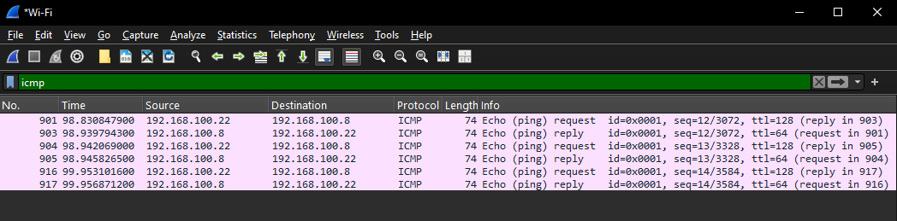
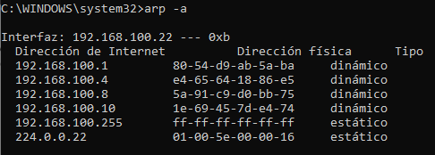
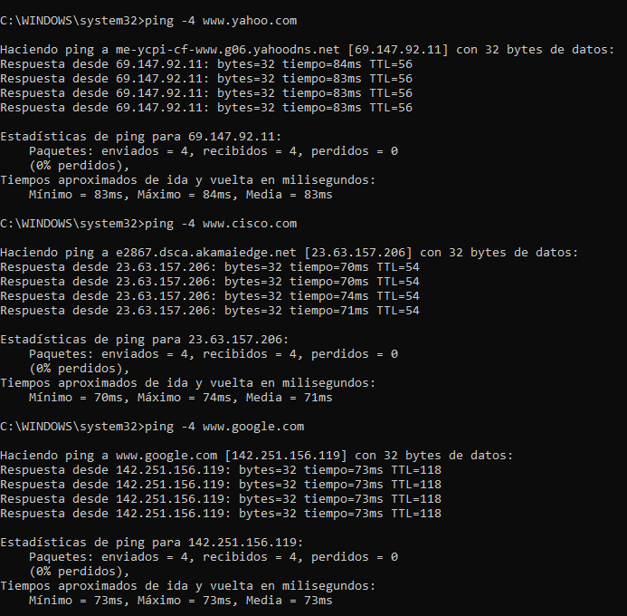
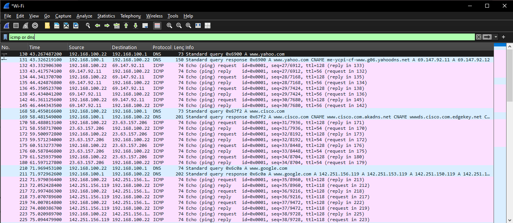
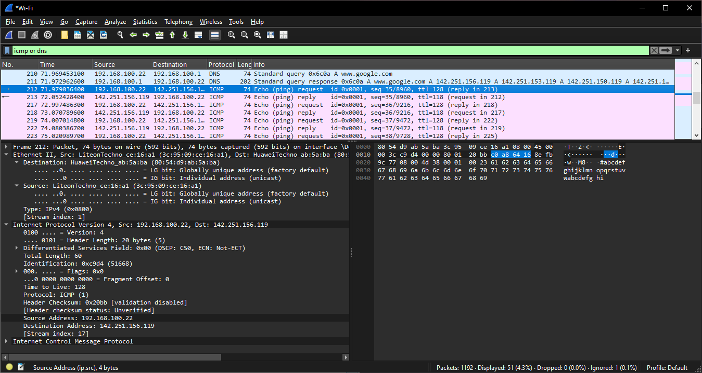
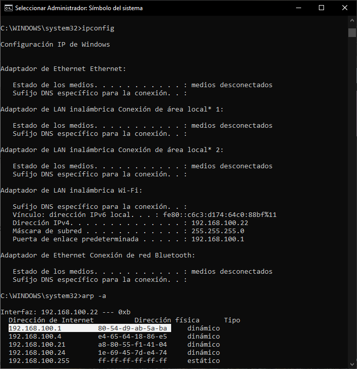

# Wireshark: ICMP and DNS Traffic Analysis on Windows
**Author:** Karen Tsiru Gonzalez Quesada | **Date:** 2026/Nov | **Environment:** Windows 10 (22H2), Wireshark 4.6.9 with Npcap 1.88
Based on the Cisco Networking Academy labs 3.7.10 (Use Wireshark to View Network Traffic) and 4.1.7 (Exploring DNS Traffic).

## Objective

Capture and analyze local and remote ICMP traffic and DNS traffic to understand how data is encapsulated (Ethernet, IP, UDP) and how names are resolved.

## Demonstrated Skills

- Packet capture and display filtering with Wireshark
- Analysis of Ethernet II, IPv4, ICMP and UDP frames
- MAC address resolution with ARP
- Analysis of DNS queries and responses (flags, CNAME, A records)
- Windows tools: ipconfig, arp, ping, nslookup, netsh

## Lab environment

I ran TShark (Wireshark) v4.0.9 to document the tools used. The lab was performed on a physical Windows PC, without a virtual machine, using the following tools:
- Windows 10 (22H2, build 19045).
- Wireshark v4.6.9
- Ncap 1.88

## Part 1: Local ICMP

### 1.1 My IP and MAC addresses

I ran `ipconfig /all` and reviewed the output for my active adapter, noting relevant details such as the MAC address, the gateway IP (which is also the DHCP-assigned IP), and the PC's IP address. 

| Adapter | IP | MAC | Default gateway |
| --- | --- | --- | --- |
| My PC | 192.168.100.22 | 3C-95-09-CE-16-A1 | 192.168.100.1 |
| Android Phone | 192.168.100.8 | 5A-91-C9-D0-BB-75 ||

### 1.2 Capturing the ping

I started Wireshark with the filter `icmp` or `arp`, cleared the ARP cache with `arp -d *`, and pinged my teammate's IP. 100% of the packets were received by my teammate's device.

Once the packets were recieved, I stopped the capture and looked at the packet list. The ping output reports 4 packets sent and 4 received, but only 3 are real Echo replies from the phone. The first line says "Destination host unreachable" and comes from my own IP (`192.168.100.22`): since I had cleared the ARP cache, Windows could not resolve the phone's MAC address in time and gave up on the first attempt without sending an Echo request. Windows counts that message as a received packet, which makes the statistics misleading. In Wireshark there are 3 Echo requests and 3 Echo replies (seq 12, 13 and 14). The 2132 ms in the second line includes the ARP resolution wait; in Wireshark the first real exchange takes about 109 ms and the others about 4 ms.The first ping attempt failed at layer 2 (ARP), before any ICMP packet was sent. This shows that a host needs the destination's MAC address before it can send an ICMP packet on the local network. Echo requests have TTL 128 (Windows) and replies have TTL 64 (the Android phone).

### 1.3 Examining the captured data

I selected the first Echo request (packet 901) and expanded the Ethernet II layer. The frame shows the source MAC `3c:95:09:ce:16:a1` (Liteon Technology) and the destination MAC `5a:91:c9:d0:bb:75`, with the Type field set to 0x0800 (IPv4). This confirms that ICMP is not sent on its own: it is carried inside an IPv4 packet, which in turn is carried inside an Ethernet II frame. The Type field is what tells the receiving device that the payload is IPv4, and Wireshark's detail pane reflects that same nesting, from Ethernet II at the outermost layer down to ICMP at the innermost. Notably, Wireshark flags the destination MAC as a locally administered address, meaning it was assigned by software rather than burned in at the factory.

ARP resolution: I looked at the ARP packets captured before the first ping. There is a request sent to the broadcast address ("Who has `192.168.100.8`? Tell `192.168.100.22`") and a reply sent only to my machine ("`192.168.100.8` is at `5a:91:c9:d0:bb:75`"); two requests went out before a single reply arrived, and later the target also asked for my IP and my machine answered. This matters because Ethernet frames are delivered by MAC address, not by IP, so the sender must first resolve which MAC owns the target IP — the request goes to every device on the local network and only the owner answers. The unanswered first request is consistent with the "Destination Host Unreachable" reported by the first ping, and the reverse exchange shows that each host resolves the other's MAC independently. The other ARP packets in the list, from `192.168.100.10`, belong to a different device on the network and are background traffic unrelated to this test.

MAC verification: I checked the phone's Wi-Fi details and ran `arp -a` on my PC. The phone reports IP 192.168.100.8 with MAC `5a:91:c9:d0:bb:75`, and its MAC address type is set to "Randomized MAC"; the ARP table on my PC lists the same pair, `192.168.100.8` → `5a:91:c9:d0:bb:75`, with type "dinámico". This confirms that the address captured in Wireshark is the phone's real on-network identity and that the ARP resolution worked as expected, while also explaining why the MAC looked unusual: it is not a factory-assigned address but one generated by Android's MAC randomization feature, which is why Wireshark flagged it as a locally administered address. The other entries in the ARP table (the router at .1, other hosts, the broadcast address, and the multicast entry) are background traffic unrelated to this test.

### Conclusion

1. Does the source MAC address match my interface? Yes. The source MAC in the capture is `3c:95:09:ce:16:a1`, which Wireshark identifies as a Liteon Technology device, and it matches the interface of my PC (`192.168.100.22`) shown in the `arp -a` output. This confirms that the Echo requests were sent from my own machine and not from another host on the network.

2. Does the destination MAC address match my teammate's? Yes. The destination MAC is `5a:91:c9:d0:bb:75`, which matches the MAC address displayed in the Wi-Fi details of the Android phone (`192.168.100.8`) and the entry for that IP in my ARP table. The phone reports its MAC address type as "Randomized MAC", which explains why Wireshark flags it as a locally administered address rather than a factory-assigned one.

3. How does my PC obtain the MAC address of the pinged device? Through ARP. Because Ethernet frames are delivered by MAC address and not by IP address, my PC first sent a broadcast ARP request ("Who has `192.168.100.8`? Tell `192.168.100.22`") to every device on the local network. Only the phone owning that IP answered, directly to my machine, with "`192.168.100.8` is at `5a:91:c9:d0:bb:75`". My PC stored that mapping in its ARP cache, which is why the entry appears as "dinámico" in `arp -a`, and used it to build the Ethernet frame for every subsequent ICMP packet. The first request went unanswered, which is consistent with the "Destination Host Unreachable" reported by the first ping; once the mapping was resolved, the remaining pings were delivered normally.

## Part 2: Remote ICMP

### 2.1 Capturing traffic to three websites

**Remote ping and TTL:** Before pinging, I ran `ipconfig /flushdns` to clear the local DNS cache, so that each name had to be resolved again from scratch and the output would show the current resolution rather than a stale cached entry — which is why the first line of each ping shows the name being resolved to an IP that differs from the one typed. I then pinged three external sites with `ping -4` and all three responded with 4 of 4 packets and 0% loss, each resolving to a different IP than the name typed: www.yahoo.com resolved to `69.147.92.11` (me-ycpi-cf-www.g06.yahoodns.net), www.cisco.com to `23.63.157.206` (e2867.dsca.akamaiedge.net), and www.google.com to `142.251.156.119` (www.google.com). The round-trip times were similar across all three — **83 ms** average for Yahoo, **71 ms** for Cisco and **73 ms** for Google — which is consistent with the three destinations being served from nearby content delivery nodes rather than from distant origin servers; the Cisco hostname in particular points to Akamai's edge network. The most informative difference is the TTL: **56** for Yahoo, **54** for Cisco and **118** for Google. Since each router along the path decrements the TTL by one, the starting value tells us how many hops the reply crossed — 64 minus 56 gives **8 hops** for Yahoo and 64 minus 54 gives **10** for Cisco, while 128 minus 118 gives **10** for Google, meaning Google's server replies with an initial TTL of 128 (a Windows-style default) instead of 64 (the Linux/Unix default used by the other two). This confirms that the replies came from three different operating systems and that the paths were short, and it also shows why TTL is a useful fingerprint when reading captures: it hints at the remote host's OS and at the distance to it, without revealing the exact route.

**DNS before ICMP:** I captured with the filter `icmp or dns`, and in the packet list the DNS queries and responses appear before the Echo requests. Before each ping, my PC sent a DNS query to resolve the site name and received a DNS response with its IP address; only after that did it send the ICMP Echo requests to that IP. This happens because `ping` needs a numeric address to build the packet, so the name has to be resolved first — which is also why the first line of each ping output shows the name being mapped to an IP that differs from the one typed. The pattern repeats three times in the capture, once per site: query 130 and response 131 for `www.yahoo.com` (resolved to `69.147.92.11`), followed by its Echo requests and replies; queries 168 and 169 for `www.cisco.com` (`23.63.157.206`); and queries 210 and 211 for `www.google.com` (`142.251.156.119`). The DNS traffic goes to the router at `192.168.100.1` as unicast rather than broadcast, which shows that my PC sends name resolution to its configured DNS server instead of asking the whole network.

### 2.2 IP and MAC addresses of the three destinations

**What I did:** For each site I selected the first Echo request and expanded Ethernet II and IPv4, and the three frames show the same structure with only the destination IP changing. The Ethernet II header carries my PC's Wi-Fi adapter as source (`3c:95:09:ce:16:a1`, Liteon Technology) and the router as destination (`80:54:d9:ab:5a:ba`, HuaweiTechno…), with EtherType `0x0800` announcing IPv4, while the IPv4 header shows version 4, header length 20 bytes, total length 60, TTL 128 and protocol 1 (ICMP). The destination IP differs per site — `69.147.92.11` for Yahoo, `23.63.157.206` for Cisco and `142.251.156.119` for Google — but the destination MAC is identical in all three, which means the packet is only addressed to the next hop and not to the remote server: the router rewrites the Ethernet header at every hop while the IP addresses stay the same end to end, so the destination IP is the only field that identifies the final target. The TTL of 128 is the Windows default set by my machine, the identification field differs in each frame (`0xb29f`, `0x87aa`, `0xc9d4`), consistent with each request being a separate datagram, and the checksum appears as "validation disabled" only because checksum validation is turned off in Wireshark's preferences, not because the checksum is wrong.

| Site | Destination IP | Destination MAC |
| --- | --- | --- |
| www.yahoo.com | 69.147.92.11 | 80:54:d9:ab:5a:ba |
| www.cisco.com | 23.63.157.206 | 80:54:d9:ab:5a:ba |
| www.google.com | 142.251.156.119 | 80:54:d9:ab:5a:ba |

I ran `ipconfig` and `arp -a` to find my default gateway and its MAC address. **What I see:** `ipconfig` lists four adapters, three of them disconnected (Ethernet, LAN inalámbrica Conexión de área local* 1 and *2, and Bluetooth), with only the Wi-Fi adapter active, holding the IPv4 address `192.168.100.22`, subnet mask `255.255.255.0` and default gateway `192.168.100.1`; `arp -a` on interface `192.168.100.22` then shows `192.168.100.1` mapped to `80-54-d9-ab-5a-ba` as a dynamic entry, alongside `192.168.100.4`, `.21` and `.24` and the static broadcast entry `192.168.100.255`. **What it means:** The gateway address from `ipconfig` and the MAC from `arp -a` are the same device, which confirms that `80:54:d9:ab:5a:ba` (HuaweiTechno…, the router) is the next hop for every packet leaving my network — exactly the destination MAC I saw in the three Echo requests. The entry is dynamic because it was learned from an ARP reply and will expire, unlike the static broadcast entry, and the other dynamic entries belong to devices on the same subnet that my PC has recently talked to. This also explains why the remote pings never carry a remote MAC: the frame is addressed to the router, which then forwards the packet toward the internet.

### Conclusion

**What is significant about this information?** The remote pings show the full path a packet takes before it leaves my network: a DNS query to the router resolves the name to an IP, and only then does `ping` build an Echo request whose Ethernet header is addressed to the gateway (`80:54:d9:ab:5a:ba`) and whose IPv4 header carries the remote destination (`69.147.92.11` for Yahoo, `23.63.157.206` for Cisco, `142.251.156.119` for Google) with TTL 128, protocol 1 and a different identification value in every frame. The replies come back with TTL 56, 54 and 118 respectively, and those values are what let me estimate the distance in hops, since each router along the way subtracts one from the TTL. The pattern is identical for all three sites, which confirms that the process is the same regardless of the destination and that the only thing changing is the resolved IP and the number of hops.

**How does it differ from the local ping in Part 1?** The local ping never needed DNS: I typed an IP address, so there was no query and no response before the ICMP exchange. The destination MAC belonged to the actual host (the phone at `192.168.100.8`, with its randomized MAC `5a:91:c9:d0:bb:75`), not to the router, because the phone is on my own subnet and the frame could be delivered directly. The TTL of the replies stayed at 64 or 128 with no decrement, since no router sat between the two devices, and the ARP exchange was visible in the capture because my PC had to discover the phone's MAC before sending anything. In Part 2 all of that changes: DNS comes first, the destination MAC is always the gateway, ARP does not appear for the remote host, and the TTL in the replies is lower than the initial value by the number of hops travelled.

**Why does Wireshark show the real MAC address of local hosts but not of remote hosts?** Because MAC addresses only exist inside a single link and never cross a router. When my PC sends a frame to the phone, both are on the same subnet, so the frame is delivered directly and Wireshark captures the phone's real MAC as the destination. When the destination is on the internet, my PC has no way to address the remote host at layer 2: it sends the frame to the default gateway, and that router strips the Ethernet header, forwards the IP packet, and builds a new Ethernet header for the next hop with its own MACs. Each hop repeats this, so the MAC addresses I would see at any point belong only to the two devices at the ends of that link, and the original remote host's MAC never reaches my capture — and would be meaningless to it anyway.

## Part 3: Capturing DNS traffic

### 3.1 Flushing the DNS cache

