# Wireshark: ICMP and DNS Traffic Analysis on Windows
**Author:** Karen Tsiru Gonzalez Quesada | **Date:** 2026/Nov | **Environment:** Windows 10 (22H2), Wireshark 4.6.9 with Npcap 1.88
Based on the Cisco Networking Academy labs 3.7.10 (Use Wireshark to View Network Traffic) and 4.1.7 (Exploring DNS Traffic).

## Objective

Capture and analyze local and remote ICMP traffic and DNS traffic to understand how data is encapsulated (Ethernet, IP, UDP) and how names are resolved.

## Demonstrated Skills

- Packet capture and display filtering with Wireshark
- Analysis of Ethernet II, IPv4, ICMP and UDP frames
- MAC address resolution with ARP
- Analysis of DNS queries and responses (flags, CNAME, A records)
- Windows tools: ipconfig, arp, ping, nslookup, netsh

## Summary

This lab follows the same question through three captures, from the machine next to me to the internet and back to a name. Part 1 stays local: I pinged a teammate's phone and watched ARP turn an IP into a MAC before any ICMP packet could leave, with echo requests and replies and one "Destination Host Unreachable". Part 2 goes outward: after `ipconfig /flushdns`, pings to Yahoo, Cisco and Google show DNS queries arriving before each ICMP exchange, destination IPs that change while the destination MAC stays the router's, and TTL values that hint at how many hops each reply travelled. Part 3 zooms into one DNS exchange: a query for `www.cisco.com` and its response, matched by transaction ID `0x0002`, with addresses and ports swapped, recursion available set to 1, and four answers walking a CNAME chain down to `23.63.157.206`, all confirmed against `ipconfig /all`, `arp -a` and `nslookup`. Together, the three parts show the same idea at three scales: a host finds its gateway by MAC, the gateway finds the name by DNS, and every claim can be checked against the packets.

## Lab environment

I ran TShark (Wireshark) v4.0.9 to document the tools used. The lab was performed on a physical Windows PC, without a virtual machine, using the following tools:
- Windows 10 (22H2, build 19045).
- Wireshark v4.6.9
- Ncap 1.88

## Part 1: Local ICMP

### 1.1 My IP and MAC addresses

I ran `ipconfig /all` and reviewed the output for my active adapter, noting relevant details such as the MAC address, the gateway IP (which is also the DHCP-assigned IP), and the PC's IP address. 

| Adapter | IP | MAC | Default gateway |
| --- | --- | --- | --- |
| My PC | 192.168.100.22 | 3C-95-09-CE-16-A1 | 192.168.100.1 |
| Android Phone | 192.168.100.8 | 5A-91-C9-D0-BB-75 ||

### 1.2 Capturing the ping

I started Wireshark with the filter `icmp` or `arp`, cleared the ARP cache with `arp -d *`, and pinged my teammate's IP. 100% of the packets were received by my teammate's device.

Once the packets were recieved, I stopped the capture and looked at the packet list. The ping output reports 4 packets sent and 4 received, but only 3 are real Echo replies from the phone. The first line says "Destination host unreachable" and comes from my own IP (`192.168.100.22`): since I had cleared the ARP cache, Windows could not resolve the phone's MAC address in time and gave up on the first attempt without sending an Echo request. Windows counts that message as a received packet, which makes the statistics misleading. In Wireshark there are 3 Echo requests and 3 Echo replies (seq 12, 13 and 14). The 2132 ms in the second line includes the ARP resolution wait; in Wireshark the first real exchange takes about 109 ms and the others about 4 ms.The first ping attempt failed at layer 2 (ARP), before any ICMP packet was sent. This shows that a host needs the destination's MAC address before it can send an ICMP packet on the local network. Echo requests have TTL 128 (Windows) and replies have TTL 64 (the Android phone).

### 1.3 Examining the captured data

I selected the first Echo request (packet 901) and expanded the Ethernet II layer. The frame shows the source MAC `3c:95:09:ce:16:a1` (Liteon Technology) and the destination MAC `5a:91:c9:d0:bb:75`, with the Type field set to 0x0800 (IPv4). This confirms that ICMP is not sent on its own: it is carried inside an IPv4 packet, which in turn is carried inside an Ethernet II frame. The Type field is what tells the receiving device that the payload is IPv4, and Wireshark's detail pane reflects that same nesting, from Ethernet II at the outermost layer down to ICMP at the innermost. Notably, Wireshark flags the destination MAC as a locally administered address, meaning it was assigned by software rather than burned in at the factory.

ARP resolution: I looked at the ARP packets captured before the first ping. There is a request sent to the broadcast address ("Who has `192.168.100.8`? Tell `192.168.100.22`") and a reply sent only to my machine ("`192.168.100.8` is at `5a:91:c9:d0:bb:75`"); two requests went out before a single reply arrived, and later the target also asked for my IP and my machine answered. This matters because Ethernet frames are delivered by MAC address, not by IP, so the sender must first resolve which MAC owns the target IP — the request goes to every device on the local network and only the owner answers. The unanswered first request is consistent with the "Destination Host Unreachable" reported by the first ping, and the reverse exchange shows that each host resolves the other's MAC independently. The other ARP packets in the list, from `192.168.100.10`, belong to a different device on the network and are background traffic unrelated to this test.

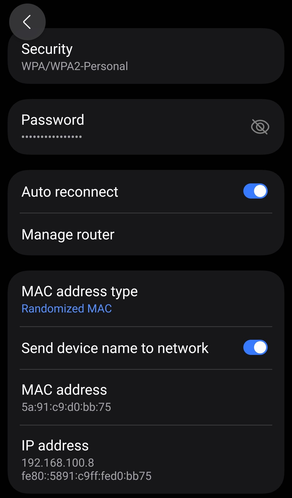

MAC verification: I checked the phone's Wi-Fi details and ran `arp -a` on my PC. The phone reports IP 192.168.100.8 with MAC `5a:91:c9:d0:bb:75`, and its MAC address type is set to "Randomized MAC"; the ARP table on my PC lists the same pair, `192.168.100.8` → `5a:91:c9:d0:bb:75`, with type "dinámico". This confirms that the address captured in Wireshark is the phone's real on-network identity and that the ARP resolution worked as expected, while also explaining why the MAC looked unusual: it is not a factory-assigned address but one generated by Android's MAC randomization feature, which is why Wireshark flagged it as a locally administered address. The other entries in the ARP table (the router at .1, other hosts, the broadcast address, and the multicast entry) are background traffic unrelated to this test.

### Part 1 Conclusion 

The source MAC `3c:95:09:ce:16:a1` matches my PC's Wi-Fi interface (`192.168.100.22`) in the `arp -a` output, so the Echo requests came from my own machine. The destination MAC `5a:91:c9:d0:bb:75` matches the Android phone (`192.168.100.8`), and its "Randomized MAC" setting explains why Wireshark flags it as locally administered. My PC learned that address through ARP: it broadcast "Who has `192.168.100.8`?", only the phone answered, and the mapping was stored as a "dinámico" entry in the ARP cache and used to build every following Ethernet frame. The first request went unanswered, which matches the "Destination Host Unreachable" of the first ping; once the mapping existed, the remaining pings were delivered normally.

## Part 2: Remote ICMP

### 2.1 Capturing traffic to three websites

Before pinging, I ran `ipconfig /flushdns` to clear the local DNS cache, so that each name had to be resolved again from scratch and the output would show the current resolution rather than a stale cached entry — which is why the first line of each ping shows the name being resolved to an IP that differs from the one typed. I then pinged three external sites with `ping -4` and all three responded with 4 of 4 packets and 0% loss, each resolving to a different IP than the name typed: www.yahoo.com resolved to `69.147.92.11` (me-ycpi-cf-www.g06.yahoodns.net), www.cisco.com to `23.63.157.206` (e2867.dsca.akamaiedge.net), and www.google.com to `142.251.156.119` (www.google.com). The round-trip times were similar across all three — **83 ms** average for Yahoo, **71 ms** for Cisco and **73 ms** for Google — which is consistent with the three destinations being served from nearby content delivery nodes rather than from distant origin servers; the Cisco hostname in particular points to Akamai's edge network. The most informative difference is the TTL: **56** for Yahoo, **54** for Cisco and **118** for Google. Since each router along the path decrements the TTL by one, the starting value tells us how many hops the reply crossed — 64 minus 56 gives **8 hops** for Yahoo and 64 minus 54 gives **10** for Cisco, while 128 minus 118 gives **10** for Google, meaning Google's server replies with an initial TTL of 128 (a Windows-style default) instead of 64 (the Linux/Unix default used by the other two). This confirms that the replies came from three different operating systems and that the paths were short, and it also shows why TTL is a useful fingerprint when reading captures: it hints at the remote host's OS and at the distance to it, without revealing the exact route.

I captured with the filter `icmp or dns`, and in the packet list the DNS queries and responses appear before the Echo requests. Before each ping, my PC sent a DNS query to resolve the site name and received a DNS response with its IP address; only after that did it send the ICMP Echo requests to that IP. This happens because `ping` needs a numeric address to build the packet, so the name has to be resolved first — which is also why the first line of each ping output shows the name being mapped to an IP that differs from the one typed. The pattern repeats three times in the capture, once per site: query 130 and response 131 for `www.yahoo.com` (resolved to `69.147.92.11`), followed by its Echo requests and replies; queries 168 and 169 for `www.cisco.com` (`23.63.157.206`); and queries 210 and 211 for `www.google.com` (`142.251.156.119`). The DNS traffic goes to the router at `192.168.100.1` as unicast rather than broadcast, which shows that my PC sends name resolution to its configured DNS server instead of asking the whole network.

### 2.2 IP and MAC addresses of the three destinations

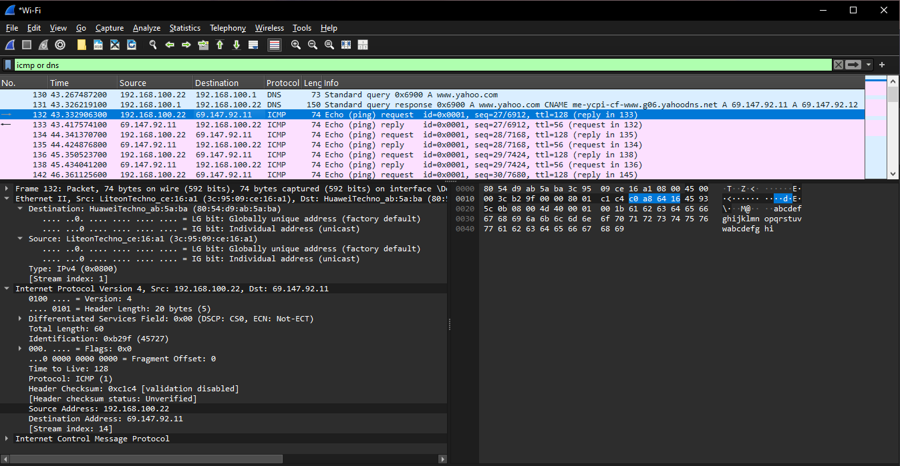
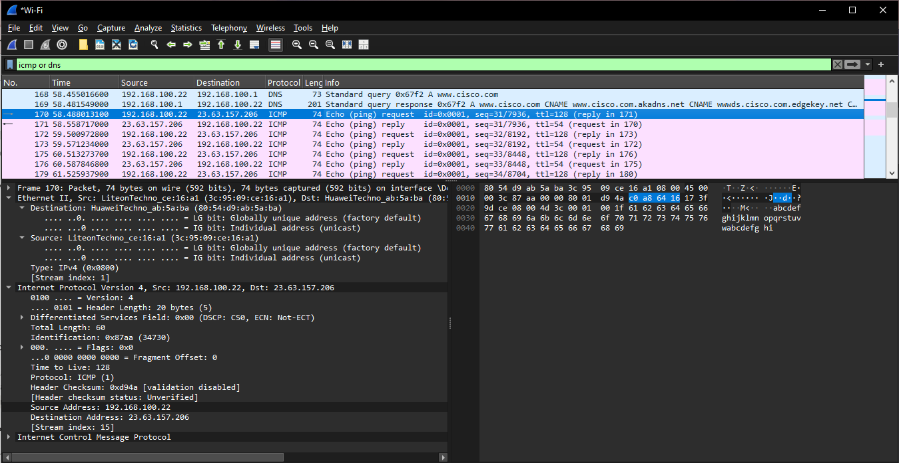

For each site I selected the first Echo request and expanded Ethernet II and IPv4, and the three frames show the same structure with only the destination IP changing. The Ethernet II header carries my PC's Wi-Fi adapter as source (`3c:95:09:ce:16:a1`, Liteon Technology) and the router as destination (`80:54:d9:ab:5a:ba`, HuaweiTechno…), with EtherType `0x0800` announcing IPv4, while the IPv4 header shows version 4, header length 20 bytes, total length 60, TTL 128 and protocol 1 (ICMP). The destination IP differs per site — `69.147.92.11` for Yahoo, `23.63.157.206` for Cisco and `142.251.156.119` for Google — but the destination MAC is identical in all three, which means the packet is only addressed to the next hop and not to the remote server: the router rewrites the Ethernet header at every hop while the IP addresses stay the same end to end, so the destination IP is the only field that identifies the final target. The TTL of 128 is the Windows default set by my machine, the identification field differs in each frame (`0xb29f`, `0x87aa`, `0xc9d4`), consistent with each request being a separate datagram, and the checksum appears as "validation disabled" only because checksum validation is turned off in Wireshark's preferences, not because the checksum is wrong.

| Site | Destination IP | Destination MAC |
| --- | --- | --- |
| www.yahoo.com | 69.147.92.11 | 80:54:d9:ab:5a:ba |
| www.cisco.com | 23.63.157.206 | 80:54:d9:ab:5a:ba |
| www.google.com | 142.251.156.119 | 80:54:d9:ab:5a:ba |

I ran `ipconfig` and `arp -a` to find my default gateway and its MAC address. `ipconfig` lists four adapters, three of them disconnected (Ethernet, LAN inalámbrica Conexión de área local* 1 and *2, and Bluetooth), with only the Wi-Fi adapter active, holding the IPv4 address `192.168.100.22`, subnet mask `255.255.255.0` and default gateway `192.168.100.1`; `arp -a` on that interface then shows `192.168.100.1` mapped to `80-54-d9-ab-5a-ba` as a dynamic entry, alongside `192.168.100.4`, `.21` and `.24` and the static broadcast entry `192.168.100.255`. The gateway address from `ipconfig` and the MAC from `arp -a` are the same device, which confirms that `80:54:d9:ab:5a:ba` (HuaweiTechno…, the router) is the next hop for every packet leaving my network, exactly the destination MAC I saw in the three Echo requests. The entry is dynamic because it was learned from an ARP reply and will expire, unlike the static broadcast entry, and the other dynamic entries belong to devices on the same subnet that my PC has recently talked to. This also explains why the remote pings never carry a remote MAC: the frame is addressed to the router, which then forwards the packet toward the internet.

### Part 2 Conclusion

The remote pings show the full path before a packet leaves my network: a DNS query to the router resolves the name, and only then does `ping` build an Echo request whose Ethernet header points to the gateway (`80:54:d9:ab:5a:ba`) while its IPv4 header carries the remote destination (`69.147.92.11` for Yahoo, `23.63.157.206` for Cisco, `142.251.156.119` for Google), with TTL 128, protocol 1 and a different identification value in each frame. The replies return with TTL 56, 54 and 118, which is how I estimate distance in hops, since every router subtracts one. The pattern repeats identically for all three sites, so the process does not depend on the destination; only the resolved IP and the hop count change.

The local ping in Part 1 never needed DNS, because I typed an IP address, so no query came before the ICMP exchange. Its destination MAC belonged to the phone itself (`5a:91:c9:d0:bb:75`), not to the router, since the phone sits on my own subnet and the frame could be delivered directly. The reply TTL stayed at 64 or 128 with no decrement because no router sat in between, and the ARP exchange appeared in the capture because my PC had to discover the phone's MAC first. In Part 2 all of that flips: DNS comes first, the destination MAC is always the gateway, no ARP appears for the remote host, and the reply TTL is lower than the initial value by the number of hops.

Wireshark shows the real MAC of local hosts but not of remote ones because MAC addresses exist only inside a single link and never cross a router. A frame to the phone is delivered directly, so its real MAC appears as the destination; a frame to the internet can only be addressed at layer 2 to the default gateway, which strips the Ethernet header, forwards the IP packet and builds a new one for the next hop. Each hop repeats this, so the MACs visible at any point belong only to the two devices at the ends of that link, and the remote host's MAC never reaches my capture.

## Part 3: Capturing DNS traffic

### 3.1 Flushing the DNS cache

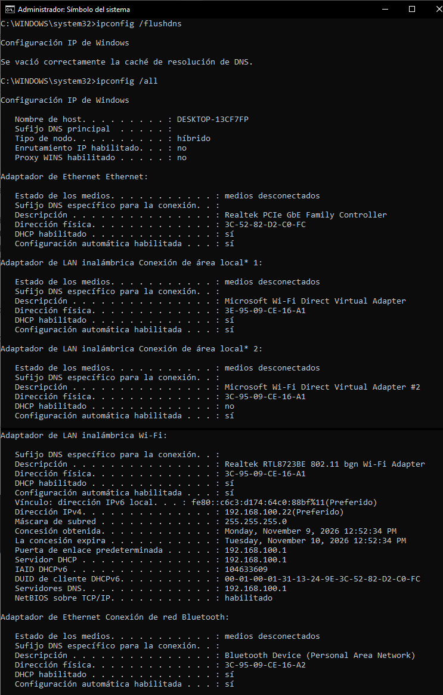

I ran `ipconfig /flushdns` and then `ipconfig /all` to record the state of my network before capturing. The first command confirmed with the message "Se vació correctamente la caché de resolución de DNS" that the cache was cleared, and the second showed the host name DESKTOP-13CF7FP with a hybrid node type and a single active adapter, the Wi-Fi one (Realtek RTL8723BE, MAC `3C-95-09-CE-16-A1`), holding the address `192.168.100.22`, mask `255.255.255.0` and default gateway `192.168.100.1`, while the Ethernet adapter (Realtek PCIe GbE, `3C-52-82-D2-C0-FC`) and the two Microsoft Wi-Fi Direct virtual adapters appear disconnected. The DNS server that will receive the query is `192.168.100.1`, the same address as the default gateway, which indicates that the router acts as the DNS forwarder for the whole network: my PC does not query an external resolver directly, it asks the router and the router forwards the request outward. That is why I flushed the cache before capturing, since otherwise Windows would have answered from its local cache and no DNS packet would have appeared in the capture at all; the hybrid node type also explains why Windows tries the cache first, then the DNS server and finally NetBIOS before failing, and the forwarder detail matters when reading the capture, because the DNS packets will show `192.168.100.22` talking to `192.168.100.1` and not to an internet address.

### 3.2 Capturing a query with nslookup

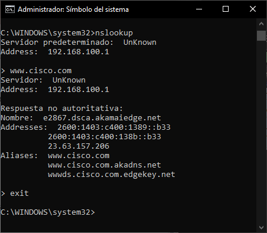

I opened `nslookup` in interactive mode and queried `www.cisco.com`. The tool reported the default server as "UnKnown" at `192.168.100.1`, and when I typed the name it answered with a non-authoritative response: the resolved name `e2867.dsca.akamaiedge.net` with three addresses, two IPv6 (`2600:1403:c400:1389::b33` and `2600:1403:c400:138b::b33`) and one IPv4 (`23.63.157.206`), plus the aliases `www.cisco.com`, `www.cisco.com.akadns.net` and `wwwds.cisco.com.edgekey.net`. The "UnKnown" label is simply the reverse lookup of the server failing, not an error: the resolver is the router at `192.168.100.1`, and it has no reverse record for itself, which is consistent with what `ipconfig /all` showed earlier and confirms the router is the DNS forwarder my PC depends on. The "Respuesta no autoritativa" (non-authoritative answer) means the reply came from a cache along the way rather than directly from the zone that owns the domain, so the values are valid but not the final word from Cisco's own servers. The alias chain is the interesting part: `www.cisco.com` is a CNAME (Canonical Name, an alias pointing to another name) to `www.cisco.com.akadns.net` and then to `wwwds.cisco.com.edgekey.net`, which resolves to `e2867.dsca.akamaiedge.net`, showing that Cisco does not serve its website from its own infrastructure but delegates to Akamai's edge network, the same content delivery network (CDN, a distributed set of servers that caches content close to users) that appeared as the destination of the ping in Part 2. That is why the address returned is an Akamai edge node and not a Cisco-owned one, and it also explains why the IPv4 address `23.63.157.206` matches the one I pinged before, while the two IPv6 addresses are what a dual-stack query returns even though the ping used IPv4.

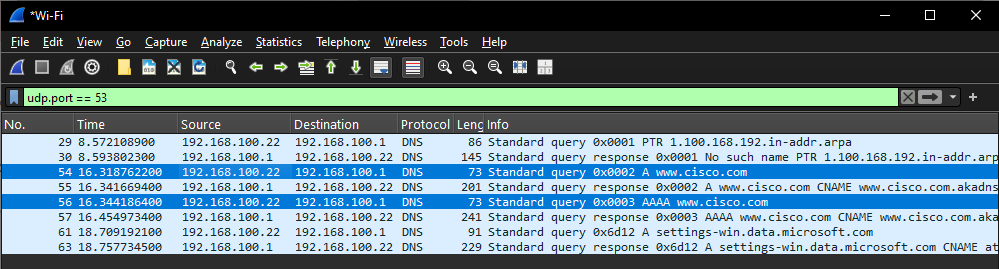

I filtered the capture with `udp.port == 53` and got six DNS packets: a PTR query and its response, then an A query and its response, then an AAAA query and its response. The PTR (Pointer record, the reverse lookup that maps an IP address back to a name) query went from `192.168.100.22` to `192.168.100.1` as "Standard query 0x0001 PTR 1.100.168.192.in-addr.arpa", and the answer came back as "Standard query response 0x0001 No such name PTR 1.100.168.192.in-addr.arpa", which is exactly the "UnKnown" that `nslookup` printed for the server name: the router has no reverse record for `192.168.100.1`, so the name lookup fails but the address itself is correct. The second pair is the A query (Address record, which maps a name to an IPv4 address) for `www.cisco.com`, sent as "Standard query 0x0002 A www.cisco.com" and answered with "Standard query response 0x0002 A www.cisco.com CNAME www.cisco.com.akadns..." in 201 bytes, and the third pair is the AAAA query (the record type for IPv6 addresses) for the same name, answered with a 241-byte response carrying the CNAME chain and the IPv6 addresses. Because the lab asks me to analyze the A query, I focus on packet 55: it is a single UDP datagram from my PC to the router carrying one question, and the response in packet 56 is longer because it has to carry the CNAME chain and the final IPv4 address, which is the same `23.63.157.206` that `nslookup` showed and that I later pinged in Part 2. The fact that the A and AAAA queries are separate transactions with their own IDs (0x0002 and 0x0003) shows that Windows asks for IPv4 and IPv6 records independently, and the last two packets about `settings-win.data.microsoft.com` are background traffic from Windows telemetry that happened to match the filter, not part of my test.

### Part 3 Conclusion

Flushing the cache first was what made the capture possible: Windows would otherwise have answered from memory and no DNS packet would exist to analyze. `ipconfig /all` showed a single active adapter, the Wi-Fi Realtek RTL8723BE at `192.168.100.22`, with `192.168.100.1` serving as both default gateway and DNS server, which means my PC never talks to an external resolver directly. The `udp.port == 53` filter then returned six packets, three queries and three answers, and the PTR pair explained the "UnKnown" that nslookup printed: the router has no reverse record for its own address. The A and AAAA queries carried separate transaction IDs because Windows asks for IPv4 and IPv6 independently, and the two `settings-win.data.microsoft.com` packets were Windows telemetry that happened to match the filter, not part of my test.

## Part 4: DNS query analysis

### 4.1 Ethernet II

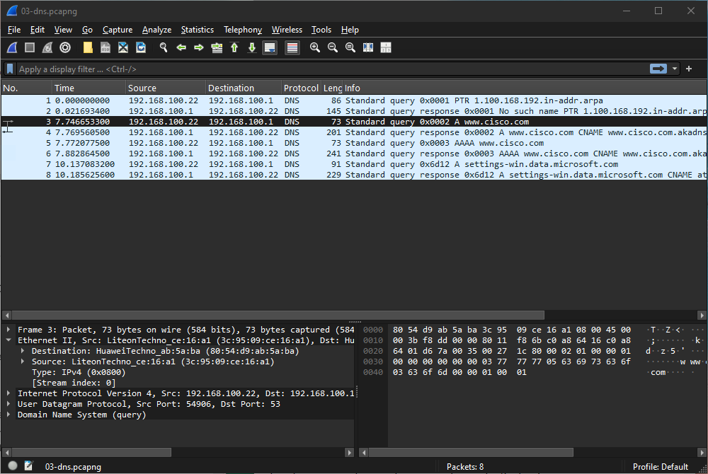

I selected the "A www.cisco.com" query (frame 3) and expanded the Ethernet II section. The source MAC is `3c:95:09:ce:16:a1`, labelled LiteonTechno_ce:16:a1, and the destination MAC is `80:54:d9:ab:5a:ba`, labelled HuaweiTechno_ab:5a:ba. The source MAC is my own Wi-Fi adapter, the same one `ipconfig /all` reported as `3C-95-09-CE-16-A1`, and the destination MAC belongs to the router, the Huawei device at `192.168.100.1` that also appeared as the gateway's MAC in the `arp -a` output and as the next hop for every remote ping in Part 2. That is the expected behaviour and not a coincidence: the DNS query is addressed to `192.168.100.1`, which is on my own local network, so the frame only has to travel one hop and the destination MAC is the router's real hardware address, resolved through ARP beforehand. The IPv4 header confirms the same path, with source `192.168.100.22` and destination `192.168.100.1`, protocol UDP with source port 54906 and destination port 53, which is the port reserved for DNS, and the frame is only 73 bytes on the wire because the question is tiny compared with the 201-byte response that has to carry the CNAME chain. This is the same link-layer logic as in Part 2: the MAC addresses only matter inside my own segment, and once the packet leaves the router toward Akamai, this Ethernet header is stripped and rebuilt with new addresses at every hop.

### 4.2 IPv4

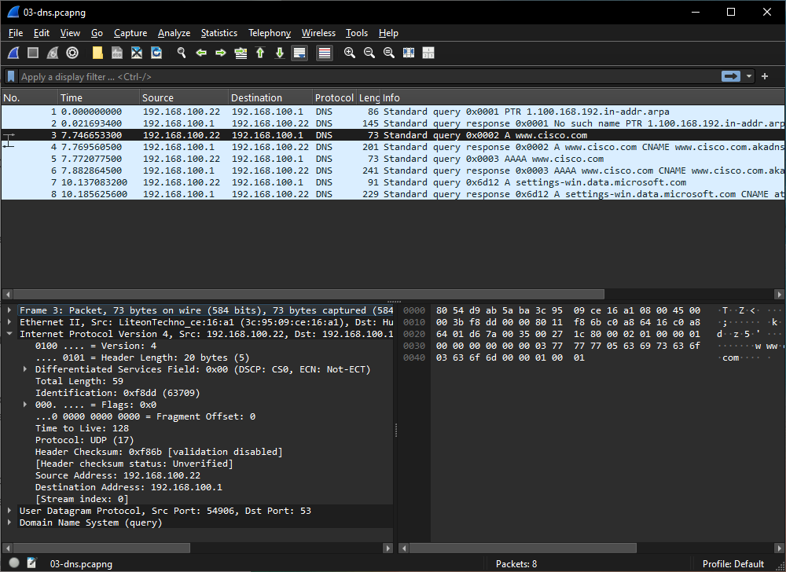

I expanded the Internet Protocol Version 4 section of the same frame 3 and found the source address `192.168.100.22` and the destination address `192.168.100.1`. The source is my PC's own IPv4 address on the Wi-Fi adapter, and the destination is the router, which is both the default gateway and the DNS server that `ipconfig /all` reported, so this query never leaves my local network as a DNS request: it goes one hop to the router, which then forwards it outward as its own query. The rest of the header supports that reading, with version 4, a header length of 20 bytes, a total length of 59 bytes, TTL 128 (the default starting value on Windows, so the packet has not been routed yet), protocol 17 (UDP, the transport protocol DNS uses for ordinary queries), identification `0xf8dd` and the flags and fragment offset all at zero, meaning the datagram is not fragmented. The checksum shows "validation disabled" only because of a Wireshark preference, not because the packet is malformed, the same note that applied to the ICMP frames in Parts 1 and 2. Comparing this with the remote pings is the useful part: there the destination IP was the public address of Yahoo, Cisco or Google and the destination MAC was still the router, while here both the destination IP and the destination MAC point to the router, which is what makes this a purely local exchange.

### 4.3 UDP

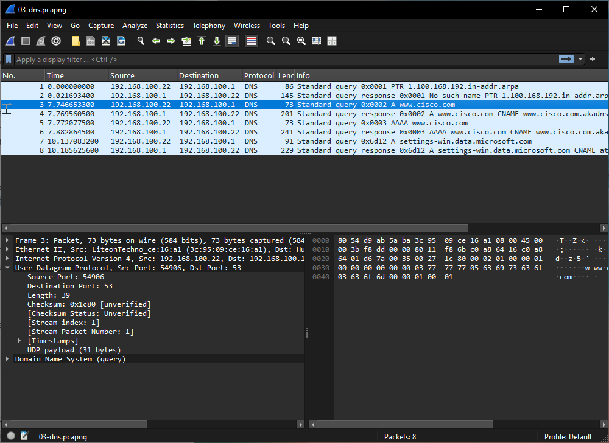

I expanded the User Datagram Protocol section of frame 3 and found the source port `54906` and the destination port `53`. The source port is ephemeral, a high number Windows picked at random for this conversation, and the destination port is 53, the standard DNS port, which is how the router knows to hand the payload to its DNS service rather than to anything else. The rest of the header fits the same picture: a UDP length of 39 bytes, which is the 8-byte UDP header plus the 31-byte DNS payload Wireshark lists below it, and a checksum of `0x1c80` marked "Unverified" because checksum validation is turned off in the preferences, the same setting that showed "validation disabled" on the IP and ICMP checksums. The useful detail is the source port: when the response comes back in frame 4, it is addressed to port 54906, which is how my PC matches the answer to the question it asked, since several applications can be talking to port 53 at once and the ephemeral port is what keeps their replies apart. This is also why the capture filter `udp.port == 53` caught the traffic in both directions, and why the whole exchange is only two datagrams, one question and one answer, with no handshake to set up a connection as TCP would need.

### 4.4 Comparing with my own configuration

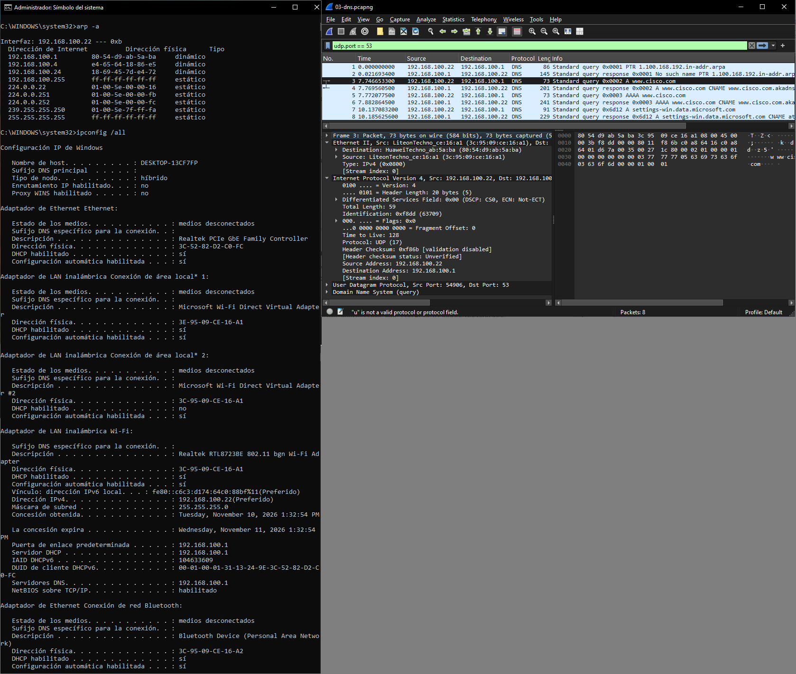

I ran `arp -a` and `ipconfig /all` and compared them with the frame I had selected in Wireshark. The `arp -a` output for interface `192.168.100.22` lists `192.168.100.1` with physical address `80-54-d9-ab-5a-ba` as a dynamic entry, and `ipconfig /all` reports the Wi-Fi adapter as a Realtek RTL8723BE with physical address `3C-95-09-CE-16-A1`, IPv4 `192.168.100.22(Preferred)`, subnet mask `255.255.255.0`, default gateway `192.168.100.1` and DNS server `192.168.100.1`, while the Ethernet adapter and the two Microsoft Wi-Fi Direct virtual adapters are all listed as "medios desconectados" (media disconnected). The addresses in Wireshark match my system exactly: the source MAC `3c:95:09:ce:16:a1` is the Realtek adapter, the destination MAC `80:54:d9:ab:5a:ba` is the router's entry in the ARP table, and the source and destination IPs `192.168.100.22` and `192.168.100.1` are the same pair `ipconfig` printed as my address and my gateway. The comparison also explains the "dinámico" label: the router's MAC has no permanent record on my machine, it was learned through ARP and will expire, whereas the `ff-ff-ff-ff-ff-ff` broadcast entries are marked "estático" because they are fixed by the protocol itself. Two details are worth noting for the write-up: the disconnected adapters still have their own MAC addresses (`3C-52-82-D2-C0-FC` for Ethernet and `3C-95-09-CE-16-A1`/`-A2` for the virtual ones), which is why the capture only ever shows the Wi-Fi interface, and the IPv6 link-local address `fe80::c6c3:d174:64c0:88bf%11` confirms the adapter index 11 that `arp -a` shows as `0xb`, tying the ARP table to the same interface the capture was taken on.

### 4.5 DNS header: flags and queries

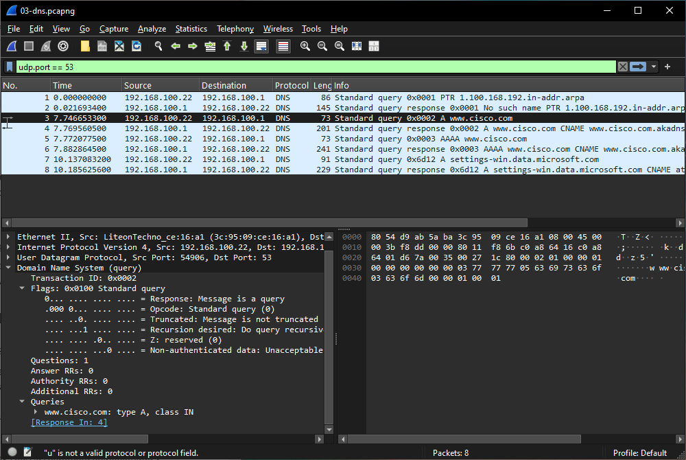

I expanded the DNS part of the query and saw the transaction ID `0x0002`. That number is a label so the reply can be matched to this question. The flags read `0x0100`, and Wireshark describes them as a standard query: the response bit is 0, so this packet is asking something rather than reporting a result, the opcode is 0 (a normal query), the packet is not truncated, the reserved bit is 0, and the non-authenticated data field says unacceptable. Under that, the counters show one question and zero answers, zero authority records and zero additional records, and the Queries section lists `www.cisco.com`, type A, class IN (Internet). The flag that stands out is Recursion desired, set to 1: my computer is saying it does not know the answer and wants the server to go find it, instead of being sent the address of another server to ask. That is what happened next, in frames 4 to 6, where the router came back with the finished answer, the Akamai canonical name and the IPv4 address, and the reply carries the same transaction ID with the response bit now set to 1. Type A means the request is only for IPv4 addresses, which is why a separate AAAA query for the same name appears later in the capture, and class IN just means this is a normal internet name.

### Part 4 Conclusion

Reading the query layer by layer showed one local hop and nothing more. The Ethernet header pointed from my adapter to the router's MAC, the IPv4 header carried the same two addresses with TTL 128 and protocol 17, and UDP used ephemeral port `54906` toward port 53. Comparing that with `arp -a` and `ipconfig /all` confirmed every value, and the `dinámico` label explained that the router's MAC was learned, not configured. The DNS header tied it together: transaction ID `0x0002`, flags `0x0100` marking a standard query, one question and no answers, and Recursion desired set to 1, asking the server to find the answer instead of pointing me to another server.

## Part 5: DNS response analysis

### 5.1 Addresses and ports in the response

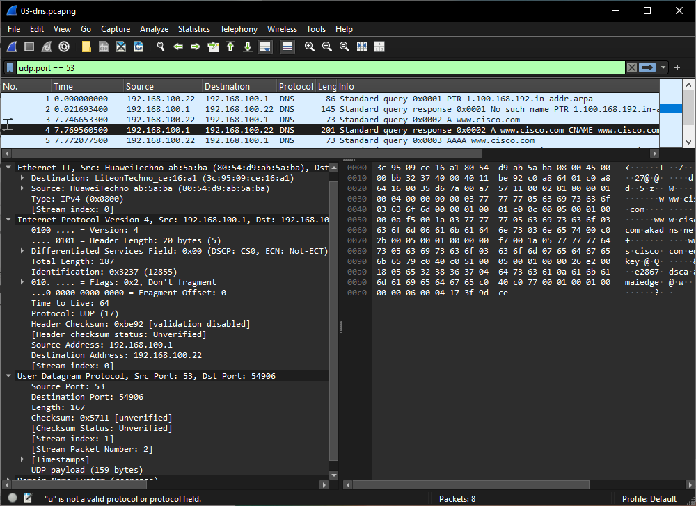

I selected the response in frame 4, the one Wireshark labels "Standard query response 0x0002 A www.cisco.com CNAME www.cisco.com.akadns.net", and expanded Ethernet II, IPv4 and UDP.

| Field | Query (frame 3) | Response (frame 4) |
| --- | --- | --- |
| Source MAC | `3c:95:09:ce:16:a1` (LiteonTechno) | `80:54:d9:ab:5a:ba` (HuaweiTechno) |
| Destination MAC | `80:54:d9:ab:5a:ba` (HuaweiTechno) | `3c:95:09:ce:16:a1` (LiteonTechno) |
| Source IP | `192.168.100.22` | `192.168.100.1` |
| Destination IP | `192.168.100.1` | `192.168.100.22` |
| Source port | `54906` | `53` |
| Destination port | `53` | `54906` |

Every field is the mirror image of the query. The two MAC addresses swap places, so the frame now comes from the router and goes to my Wi-Fi adapter, and the two IP addresses swap the same way, from `192.168.100.1` to `192.168.100.22`. The ports do it too: the answer leaves port 53, the DNS service, and lands on `54906`, the ephemeral port my computer opened for this one question, which is how Windows knows this reply belongs to that query and not to another program's. The rest of the header tells the same story of a local, one-hop packet: TTL 64 instead of 128, because the router generated this packet itself rather than forwarding one, total length 187 bytes against the query's 59, and identification `0x3237`, different from the query's `0xf8dd`, since this is a new datagram and not a fragment of the old one. The UDP length of 167 bytes is the 8-byte header plus the 159-byte DNS payload, which is much bigger than the query's because it now carries the CNAME chain and the address record, and the checksums again show "Unverified" only because validation is switched off in the preferences. The useful conclusion for the write-up is that a DNS exchange is a strict swap of addresses and ports in both directions, with the ephemeral port acting as the return ticket.

### 5.2 Flags, queries and answers

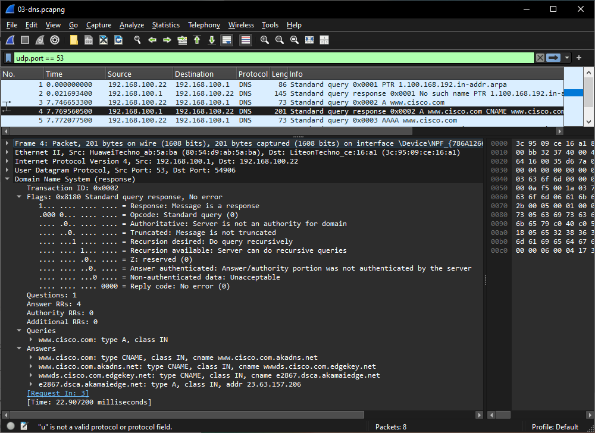

I expanded the DNS part of the response and saw the same transaction ID `0x0002` as the query, which is how this packet gets matched to that question. The flags now read `0x8180` and Wireshark describes them as a standard query response with no error: the response bit is 1, so this is an answer, the opcode is still 0, the server says it is not authoritative for the domain (it is passing on an answer it got from somewhere else, not one it owns), the packet is not truncated, Recursion desired is still 1 as my computer had asked, and the flag that answers the guide question is Recursion available, also set to 1, meaning the server does support recursive queries and was willing to go find the full answer for me. The remaining flags show the reserved bit at 0, the answer not authenticated, non-authenticated data unacceptable and a reply code of 0, no error. The counters changed from the query's one question and zero answers to one question and four answers, with zero authority and zero additional records, and the Answers section lists those four records in order: `www.cisco.com` as a CNAME pointing to `www.cisco.com.akadns.net`, that name as another CNAME pointing to `wwwds.cisco.com.edgekey.net`, that name as a third CNAME pointing to `e2867.dsca.akamaiedge.net`, and finally that last name as type A with the address `23.63.157.206`. So the server did not just hand back one address; it walked the chain of names and returned every step, which is exactly the work the Recursion desired flag asked for, and the final address is the same one nslookup printed and the same one I pinged in Part 2. Wireshark also shows the time from the request as 22.907200 milliseconds, so the whole chain was resolved in about 23 ms.

### 5.3 CNAME and A records compared with nslookup

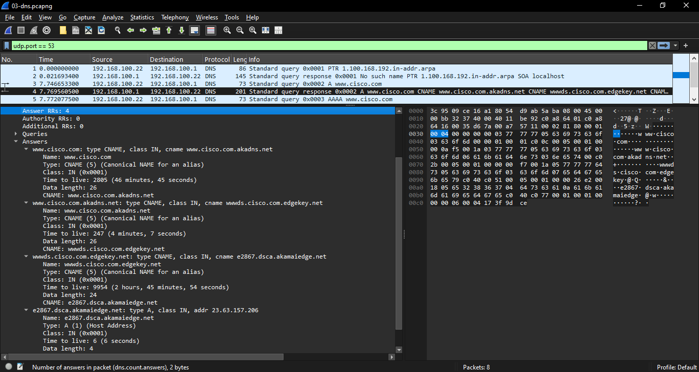

I compared the CNAME and A records in the Answers section with the nslookup output from the same name. In Wireshark the four records appear in full detail: `www.cisco.com` as a CNAME with time to live 2805 (46 minutes, 45 seconds) pointing to `www.cisco.com.akadns.net`, that name as a CNAME with TTL 247 (4 minutes, 7 seconds) pointing to `wwwds.cisco.com.edgekey.net`, that name as a CNAME with TTL 9954 (2 hours, 45 minutes, 54 seconds) pointing to `e2867.dsca.akamaiedge.net`, and finally that last name as type A, class IN, with address `23.63.157.206` and TTL 6 (6 seconds). nslookup shows the same thing in a shorter form: the name `e2867.dsca.akamaiedge.net`, the two IPv6 addresses and the IPv4 `23.63.157.206`, plus the alias list `www.cisco.com`, `www.cisco.com.akadns.net` and `wwwds.cisco.com.edgekey.net`. So the similarities are the same chain of aliases and the same final IPv4 address, which confirms both tools are reporting one and the same DNS answer, and the differences are mostly about how much detail each one shows: Wireshark gives the type, the class, the time to live and the length of every record, while nslookup gives a summary with just the names and addresses. The TTL values are the interesting extra, because they say how long each record may stay in a cache before it has to be asked again, and the last one being only 6 seconds is typical of a CDN address that changes often. nslookup also showed the IPv6 addresses because it asks for both kinds of records, whereas this particular capture only followed the IPv4 query.

### Part 5 Conclusion

The response is the query reversed field by field: MACs and IPs swapped, port 53 answering port `54906`, TTL 64 because the router generated the packet itself, and a much larger payload carrying the full CNAME chain. The flags changed to `0x8180`, with the response bit set, the server declaring itself non-authoritative, and Recursion available set to 1, which confirms it does resolve names on my behalf. The four answers walked `www.cisco.com` through two Akamai aliases down to `23.63.157.206` in about 23 ms, the same address nslookup printed and the same one I pinged in Part 2. Wireshark and nslookup agreed on the aliases and the IPv4 address, differing only in detail: Wireshark exposed type, class and time to live, with the final record's TTL of 6 seconds typical of a CDN address that changes often.

## General Conclusion

Across the three parts of this lab I moved from the closest traffic to the most distant. In the local capture I pinged a teammate's phone and saw ARP resolve an IP into a MAC before any ICMP packet could leave, with echo requests and replies and a "Destination Host Unreachable" showing how a host announces it cannot find its target. In the remote capture I pinged Yahoo, Cisco and Google and learned that the destination IP changes but the destination MAC stays the router's, that DNS queries come first so a name can become an address, and that TTL values reveal how many hops a reply has travelled. In the DNS capture I followed one query end to end and confirmed it against `ipconfig /all`, `arp -a` and `nslookup`: the transaction ID and ephemeral port pair the question with its answer, the response mirrors the query, and recursion lets the router resolve the name for me. For the CCST Cybersecurity badge, this is hands-on practice in network fundamentals, traffic monitoring and evidence-based analysis, the everyday work of a SOC analyst.

