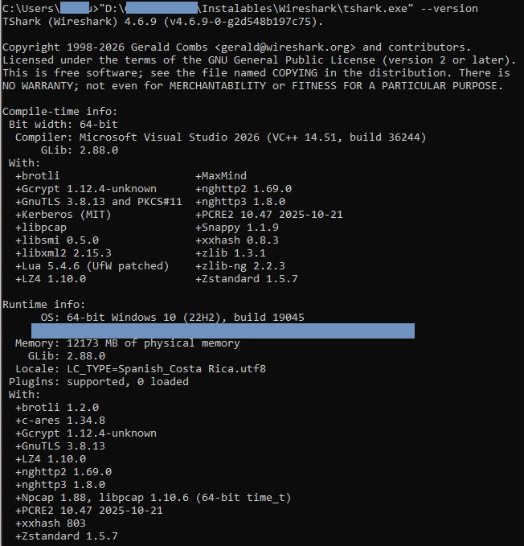
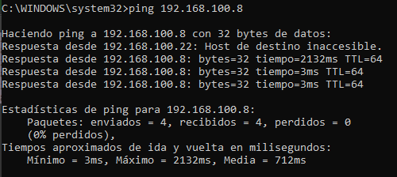

# Wireshark: ICMP and DNS Traffic Analysis on Windows
**Author:** Karen Tsiru Gonzalez Quesada | **Date:** 2026/Nov | **Environment:** Windows 10 (22H2), Wireshark 4.6.9 with Npcap 1.88
Based on the Cisco Networking Academy labs 3.7.10 (Use Wireshark to View Network Traffic) and 4.1.7 (Exploring DNS Traffic).

## Objective

Capture and analyze local and remote ICMP traffic and DNS traffic to understand how data is encapsulated (Ethernet, IP, UDP) and how names are resolved.

## Demonstrated Skills

- Packet capture and display filtering with Wireshark
- Analysis of Ethernet II, IPv4, ICMP and UDP frames
- MAC address resolution with ARP
- Analysis of DNS queries and responses (flags, CNAME, A records)
- Windows tools: ipconfig, arp, ping, nslookup, netsh

## Lab environment

I ran TShark (Wireshark) v4.0.9 to document the tools used. The lab was performed on a physical Windows PC, without a virtual machine, using the following tools:
- Windows 10 (22H2, build 19045).
- Wireshark v4.6.9
- Ncap 1.88

## Part 1: Local ICMP

### 1.1 My IP and MAC addresses

I ran `ipconfig /all` and reviewed the output for my active adapter, noting relevant details such as the MAC address, the gateway IP (which is also the DHCP-assigned IP), and the PC's IP address. 

| Adapter | IP | MAC | Default gateway |
| --- | --- | --- | --- |
| My PC | 192.168.100.22 | 3C-95-09-CE-16-A1 | 192.168.100.1 |
| Android Phone | 192.168.100.8 | 5A-91-C9-D0-BB-75 ||

### 1.2 Capturing the ping

I started Wireshark with the filter `icmp` or `arp`, cleared the ARP cache with `arp -d *`, and pinged my teammate's IP. 100% of the packets were received by my teammate's device.

Once the packets were recieved, I stopped the capture and looked at the packet list. The ping output reports 4 packets sent and 4 received, but only 3 are real Echo replies from the phone. The first line says "Destination host unreachable" and comes from my own IP (192.168.100.22): since I had cleared the ARP cache, Windows could not resolve the phone's MAC address in time and gave up on the first attempt without sending an Echo request. Windows counts that message as a received packet, which makes the statistics misleading. In Wireshark there are 3 Echo requests and 3 Echo replies (seq 12, 13 and 14). The 2132 ms in the second line includes the ARP resolution wait; in Wireshark the first real exchange takes about 109 ms and the others about 4 ms.The first ping attempt failed at layer 2 (ARP), before any ICMP packet was sent. This shows that a host needs the destination's MAC address before it can send an ICMP packet on the local network. Echo requests have TTL 128 (Windows) and replies have TTL 64 (the Android phone).

### 1.3 Examining the captured data

