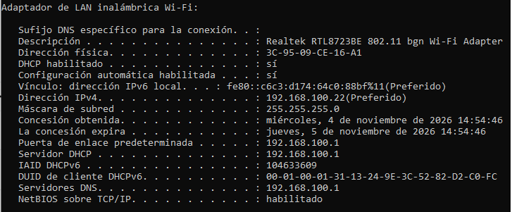
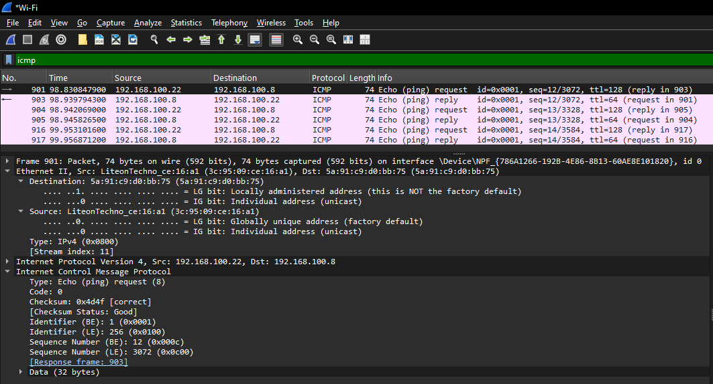
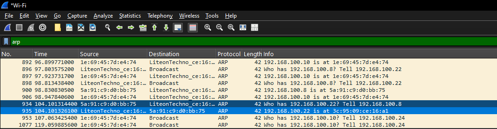

# Wireshark: ICMP and DNS Traffic Analysis on Windows
**Author:** Karen Tsiru Gonzalez Quesada | **Date:** 2026/Nov | **Environment:** Windows 10 (22H2), Wireshark 4.6.9 with Npcap 1.88
Based on the Cisco Networking Academy labs 3.7.10 (Use Wireshark to View Network Traffic) and 4.1.7 (Exploring DNS Traffic).

## Objective

Capture and analyze local and remote ICMP traffic and DNS traffic to understand how data is encapsulated (Ethernet, IP, UDP) and how names are resolved.

## Demonstrated Skills

- Packet capture and display filtering with Wireshark
- Analysis of Ethernet II, IPv4, ICMP and UDP frames
- MAC address resolution with ARP
- Analysis of DNS queries and responses (flags, CNAME, A records)
- Windows tools: ipconfig, arp, ping, nslookup, netsh

## Lab environment

I ran TShark (Wireshark) v4.0.9 to document the tools used. The lab was performed on a physical Windows PC, without a virtual machine, using the following tools:
- Windows 10 (22H2, build 19045).
- Wireshark v4.6.9
- Ncap 1.88

## Part 1: Local ICMP

### 1.1 My IP and MAC addresses

I ran `ipconfig /all` and reviewed the output for my active adapter, noting relevant details such as the MAC address, the gateway IP (which is also the DHCP-assigned IP), and the PC's IP address. 

| Adapter | IP | MAC | Default gateway |
| --- | --- | --- | --- |
| My PC | 192.168.100.22 | 3C-95-09-CE-16-A1 | 192.168.100.1 |
| Android Phone | 192.168.100.8 | 5A-91-C9-D0-BB-75 ||

### 1.2 Capturing the ping

I started Wireshark with the filter `icmp` or `arp`, cleared the ARP cache with `arp -d *`, and pinged my teammate's IP. 100% of the packets were received by my teammate's device.

Once the packets were recieved, I stopped the capture and looked at the packet list. The ping output reports 4 packets sent and 4 received, but only 3 are real Echo replies from the phone. The first line says "Destination host unreachable" and comes from my own IP (192.168.100.22): since I had cleared the ARP cache, Windows could not resolve the phone's MAC address in time and gave up on the first attempt without sending an Echo request. Windows counts that message as a received packet, which makes the statistics misleading. In Wireshark there are 3 Echo requests and 3 Echo replies (seq 12, 13 and 14). The 2132 ms in the second line includes the ARP resolution wait; in Wireshark the first real exchange takes about 109 ms and the others about 4 ms.The first ping attempt failed at layer 2 (ARP), before any ICMP packet was sent. This shows that a host needs the destination's MAC address before it can send an ICMP packet on the local network. Echo requests have TTL 128 (Windows) and replies have TTL 64 (the Android phone).

### 1.3 Examining the captured data

I selected the first Echo request (packet 901) and expanded the Ethernet II layer. The frame shows the source MAC 3c:95:09:ce:16:a1 (Liteon Technology) and the destination MAC 5a:91:c9:d0:bb:75, with the Type field set to 0x0800 (IPv4). This confirms that ICMP is not sent on its own: it is carried inside an IPv4 packet, which in turn is carried inside an Ethernet II frame. The Type field is what tells the receiving device that the payload is IPv4, and Wireshark's detail pane reflects that same nesting, from Ethernet II at the outermost layer down to ICMP at the innermost. Notably, Wireshark flags the destination MAC as a locally administered address, meaning it was assigned by software rather than burned in at the factory.

ARP resolution: I looked at the ARP packets captured before the first ping. There is a request sent to the broadcast address ("Who has 192.168.100.8? Tell 192.168.100.22") and a reply sent only to my machine ("192.168.100.8 is at 5a:91:c9:d0:bb:75"); two requests went out before a single reply arrived, and later the target also asked for my IP and my machine answered. This matters because Ethernet frames are delivered by MAC address, not by IP, so the sender must first resolve which MAC owns the target IP — the request goes to every device on the local network and only the owner answers. The unanswered first request is consistent with the "Destination Host Unreachable" reported by the first ping, and the reverse exchange shows that each host resolves the other's MAC independently. The other ARP packets in the list, from 192.168.100.10, belong to a different device on the network and are background traffic unrelated to this test.

MAC verification: I checked the phone's Wi-Fi details and ran `arp -a` on my PC. The phone reports IP 192.168.100.8 with MAC 5a:91:c9:d0:bb:75, and its MAC address type is set to "Randomized MAC"; the ARP table on my PC lists the same pair, 192.168.100.8 → 5a:91:c9:d0:bb:75, with type "dinámico". This confirms that the address captured in Wireshark is the phone's real on-network identity and that the ARP resolution worked as expected, while also explaining why the MAC looked unusual: it is not a factory-assigned address but one generated by Android's MAC randomization feature, which is why Wireshark flagged it as a locally administered address. The other entries in the ARP table (the router at .1, other hosts, the broadcast address, and the multicast entry) are background traffic unrelated to this test.

## Part 1 conclussion

1. Does the source MAC address match my interface? Yes. The source MAC in the capture is 3c:95:09:ce:16:a1, which Wireshark identifies as a Liteon Technology device, and it matches the interface of my PC (192.168.100.22) shown in the `arp -a` output. This confirms that the Echo requests were sent from my own machine and not from another host on the network.

2. Does the destination MAC address match my teammate's? Yes. The destination MAC is 5a:91:c9:d0:bb:75, which matches the MAC address displayed in the Wi-Fi details of the Android phone (192.168.100.8) and the entry for that IP in my ARP table. The phone reports its MAC address type as "Randomized MAC", which explains why Wireshark flags it as a locally administered address rather than a factory-assigned one.

3. How does my PC obtain the MAC address of the pinged device? Through ARP. Because Ethernet frames are delivered by MAC address and not by IP address, my PC first sent a broadcast ARP request ("Who has 192.168.100.8? Tell 192.168.100.22") to every device on the local network. Only the phone owning that IP answered, directly to my machine, with "192.168.100.8 is at 5a:91:c9:d0:bb:75". My PC stored that mapping in its ARP cache, which is why the entry appears as "dinámico" in `arp -a`, and used it to build the Ethernet frame for every subsequent ICMP packet. The first request went unanswered, which is consistent with the "Destination Host Unreachable" reported by the first ping; once the mapping was resolved, the remaining pings were delivered normally.
